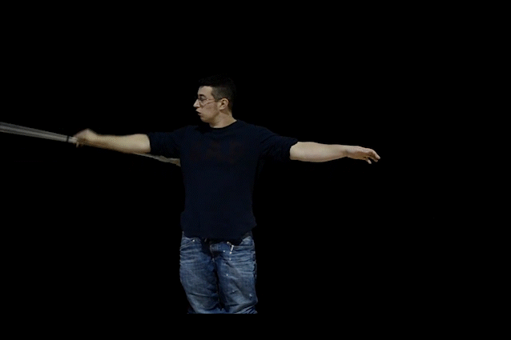

# Angel Roll

---
status: Learned
family: Angel
category: Fundamental
need: 5
difficulty: 2
mastery: 🌟🌟🌟🌟
Extra notes: Will need to learn left hand at some point
Improvement notes: My left arm needs to be bent back more
ingest: No
propType: Contact
Where was it first learned: MCP
id:9510e7cb40024c3f8aac00c8644f43ee
---

The Angel Roll. A straight arm version of the halo roll. The arms always remain straight. Firstly you start it from reverse spinning, or reverse fishtails as I show in the vid. (darkly) I generally give the staff a pull toward me, to give it some ooph, then straighten my arm out again. You might find it easier to lift your arm higher than I do. I've managed to train myself out of that somewhat.

So reverse. As the top end is coming vertical and coming over, pull it toward yourself slightly and try and go into a fishtail almost. It's kinda like half a reverse fishtail that rolls up your arm. It should step on the front side of your elbow then go into the standard halo roll.

The second half is the mirror of the first. Have this arm straight out and ready, and don't let it fall down. Having it up and level will make the move easier. Sometimes pushing it back so that the staff finds it easier to step on the front side of your elbow helps too.

If you're keeping both arms level through out the move, and having it just step nicely into your hand at the end, you're doing well. Obviously, learn a halo roll before you learn this.

