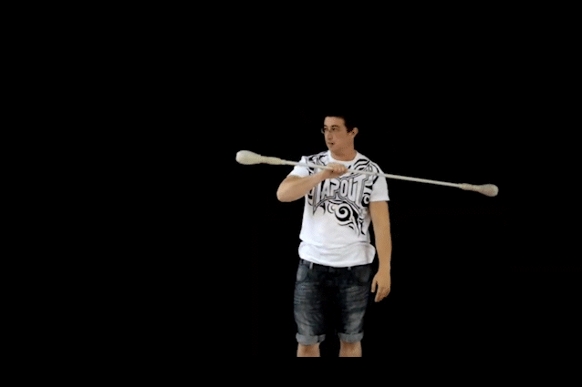

# Caged

---
Status: Learned
Family: Steve
Category: Transfer
How badly do I need it: ⭐⭐⭐
Difficulty: 💀💀💀
Mastery: 🌟🌟🌟🌟
Ingest: No
Staff Type: Contact
id: 54975b188346467ea09fd48dbde46511
---

A 'caged' steve, is a steve which occurs in the round space you can make if your touch the fingers of your hands together. The staff is in this space and sometimes you have to have your arms above your head and held down in order to let the staff roll around in it. Generally if you have a long staff you can't get it out of this space without breaking the space by detaching your hands from each other. Hence the name 'caged'.

Now you can't do a normal steve with your arms caging the staff, but you can do a couple of steve variants, like a chest steve, or a minimal beat steve. (Because these don't rotate enough to get stuck... as it were...)

The minimal beat variation is my favourite at the moment, thou my cage is not very closed. Be assured however that you can do this movement fully closed. It's probably easier actually.

Plus you can mix minimal and chest steves in the cage, they're interchangeable and can be both be done continuously.

[https://www.youtube.com/watch?v=cowneMEMT0I](https://www.youtube.com/watch?v=cowneMEMT0I)

[https://youtu.be/beg5nuTp-Vo](https://youtu.be/beg5nuTp-Vo)
