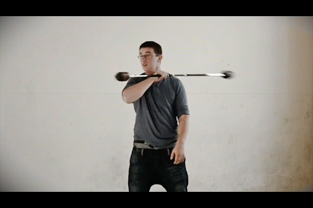

# Chest Spins

---
Status: Cool stuff
Family: Neck
How badly do I need it: 4
Difficulty: 5
Unlocks: Throat Wrap (Throat%20Wrap%2057c89f1f2ad64882b611d87a7c995a6d.md)
Ingest: No
Staff Type: Contact
id: 59c85424b5dd4afd8f1a1ab9a773ebfc
---

Well I don't think they're a very elegant or beautiful move, but they are quite fun and everybody else was learning them and I felt left out... so I learnt them too.

What happens is this you do a neck wrap let it come round to do a throat wrap, but lean hella far back and make a nice horizontal area of chest for it to do a spin on. Then it should go back into a back of the neck wrap.

Yes, you could do multiple chest spins if you're bendy.

Yes, if you were bendy you could do chest spins out of a half matrix if you're very bendy.

You can alternate from back of neck spin to chest spin and back again continuously if you practise.

You can probably shimmy your shoulders to keep chest spins going continuously...

and in a similar but different move, you can do these with turning, but then it very much becomes a case of throat wrap, chest halo, throat wrap, chest halo. Not so much a spin but a definite series of wraps.

[https://www.youtube.com/watch?v=NrrVJoK-_z8](https://www.youtube.com/watch?v=NrrVJoK-_z8)

[https://youtu.be/GuCoooETxH0](https://youtu.be/GuCoooETxH0)
