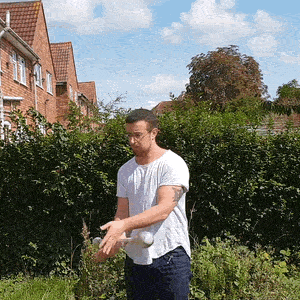

# Contact Weave

---
Status: Learned
Family: Arms
How badly do I need it: 3
Difficulty: 2
Mastery: 3
Extra notes: Need to learn violinning
Ingest: No
Staff Type: Contact
id: 49ccae5293544b3193a41f1caea85c55
---

Thanks Knoxious! ;) The contact weave. Hopefully fairly obvious to begin with... Go check out the videos of knox on soton-firespinning if you want to see another tutorial...

One hand underneath, one on top and they swap which is on the bottom as the staff spins in a figure of eight.

A few variations on hand positions are shown at the end. And it's debatable whether an extra beat version is possible. (Or elegant.)

[https://youtu.be/Z0xlUHOfjik](https://youtu.be/Z0xlUHOfjik)

[https://youtu.be/r_pezu3eeZc](https://youtu.be/r_pezu3eeZc)
