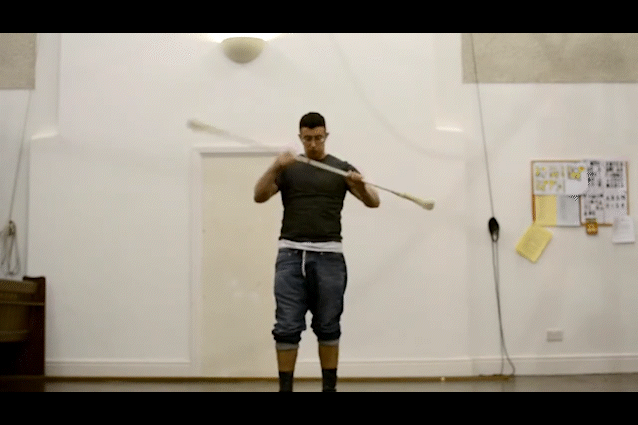

# Cork move

---
Status: Cool stuff
Family: Angel
How badly do I need it: 4
Difficulty: 5
Ingest: No
Staff Type: Contact
Where was it first learned: MCP
id: 69d17f677c4f40b5b348a1aee9fe8b7d
---

A btb entrance to a turn vertical arm roll transfer sorta thing. I found it in cork and so named it after that.

[https://youtu.be/GpregnCBylU](https://youtu.be/GpregnCBylU)
