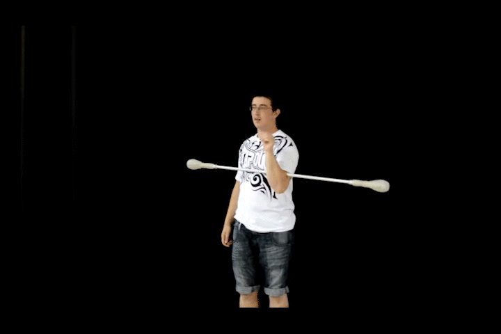

# Elbow trap Steve

---
Status: Up next
Family: Steve
How badly do I need it: ⭐⭐⭐⭐⭐
Difficulty: 💀
Mastery: 🌟🌟
Ingest: No
Staff Type: Contact
Where was it first learned: MCP
id: 138d609b8c954a1a92150db9b4479972
---

Argh, to go in the elbow section or the steve section! ARGH! So there are two ways to come out of an elbow trap, toward your body and away from it. (talking about the end of the staff that's nearest your body.) I do this move with the staff going away from me, to a normal half steve and catching in the lock on the other side.

Unfortunately I've now just realised that I probably can do it with the throat wrap part of the full steve. Which is annoying, cos I'll have to go learn it, and that's led me to the realisation I can probably go to a horizontal angel roll too. Bugger.

Anyway, prerequisites for this move, half steve in both directions, as well as elbow traps.

[https://www.youtube.com/watch?v=0LIFsiyFoHw](https://www.youtube.com/watch?v=0LIFsiyFoHw)
