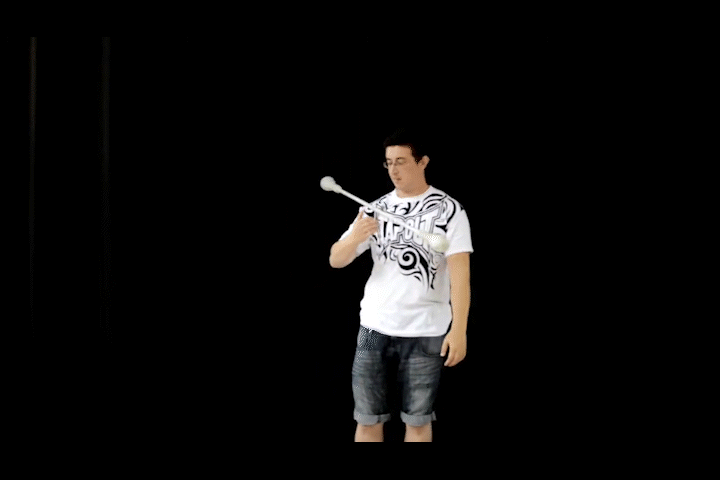

# Forearm Roll

---
Status: Learned
Family: Steve
How badly do I need it: 4
Difficulty: 3
Mastery: 5
Extra notes: Kinda like the Greg’s move but with extra left arm bits
Ingest: No
Staff Type: Contact
id: a95904d5c5384ac59c4507c5336c978a
---

Forearm rolls are short continuous rolls that go up and down your forearms. They are horizontal, in this case.

[Forearm Rolls - Contact Staff Tutorial - mcp (720p_24fps_H264-192kbit_AAC).mp4](Forearm%20Roll/Forearm_Rolls_-_Contact_Staff_Tutorial_-_mcp_(720p_24fps_H264-192kbit_AAC).mp4)
