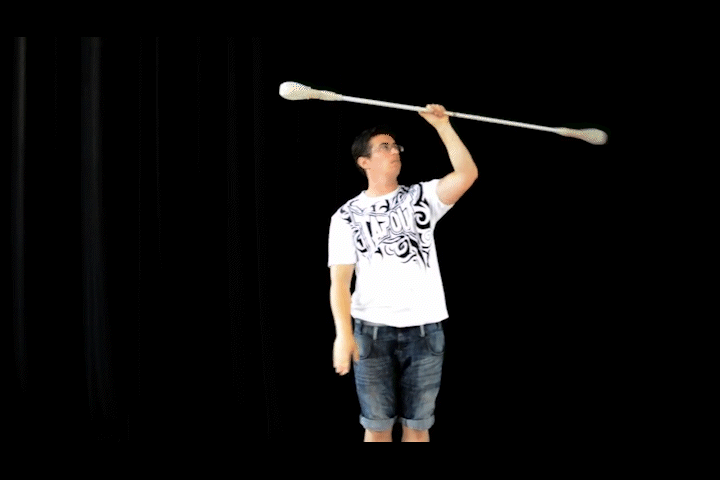

# Full Steve

---
Status: Learned
Family: Steve
How badly do I need it: ⭐⭐⭐⭐
Difficulty: 💀💀💀
Mastery: 🌟🌟🌟🌟🌟
Ingest: No
Staff Type: Contact
id: daf4ee34f9e7462b9b88b3d7f1f31189
---

The full steve, badly done twice. (With extra bits sometimes.) Should ideally be a controlled in-plane continuous move.

Basically, you do a Steve, and at the end, you either go into a palm spin and come back out down the other side of the arm, or do a horizontal hand wrap, to get it to come down the underside of your arm. (the underside obviously being held up at this point) The staff should wrap your throat (very hard, mine mostly steps to the other arm), roll up the underside of the other arm and into palm-spin. (And oh yes, you can do them continuously.)

[Full Steve - Contact Staff Tutorial - mcp (720p_24fps_H264-192kbit_AAC).mp4](Full%20Steve/Full_Steve_-_Contact_Staff_Tutorial_-_mcp_(720p_24fps_H264-192kbit_AAC).mp4)
