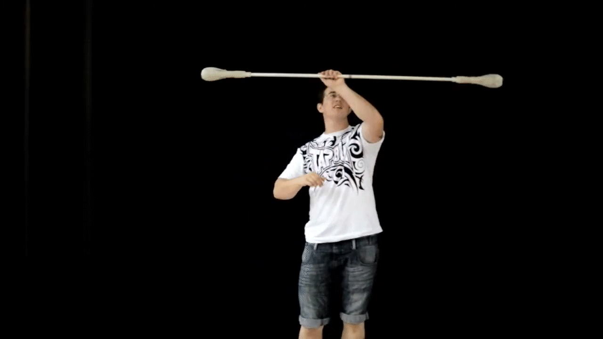

# Greg's Move - 3/4 Forearm Rolls

---
Status: Learned
Family: Steve
How badly do I need it: 4
Difficulty: 4
Mastery: 1
Extra notes: Made OBE by forearm rolls
Ingest: No
Staff Type: Contact
Where was it first learned: MCP
id: fe140f2a293b4fa4abe60dba087d7f87
---

How I learn forearm rolls, from a contact club move I learnt from greg. This is the first 3/4 of full forearm rolls and should be learnt before. Also it has one full forearm roll in it…

[[Gregs move] 3_4 Forearm Rolls - Contact Staff Tutorial - mcp (720p_24fps_H264-192kbit_AAC).mp4](Greg's%20Move%20-%203%204%20Forearm%20Rolls/Gregs_move_3_4_Forearm_Rolls_-_Contact_Staff_Tutorial_-_mcp_(720p_24fps_H264-192kbit_AAC).mp4)
