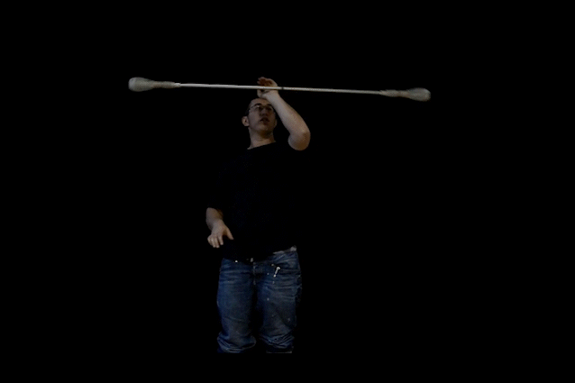

# Half Steve

---
Status: Learned
Family: Steve
How badly do I need it: 5
Difficulty: 3
Mastery: 5
Ingest: No
Staff Type: Contact
Where was it first learned: MCP
id: c4a74b27dffe4c939ae2fbf7be4b1b35
---

Soon young jedi, this move will gain it's own rhythm and you will be able to do it continuously and perfectly and fast and smoothly. And then you will finally feel HARDCORE.

Tips:

On all neck wraps: on the exit side of a wrap, if it's still beside your neck and not further down your back, this is good.

Strive to get your arm rolls on the top of your arm.

Strive for the control that will let you let the staff wrap the front of your neck.

If you can do this move in the light but not the dark, it's because you're sighting the centre of the staff on it's way down your arm, and you can't do that in the dark (duh!) I do this to. I know of no cure but the perennial - practise more in the dark. (Or get a glowing staff - yay I can see it!)

This move is sooooooo cool

[https://youtu.be/qczxgTEIeUM](https://youtu.be/qczxgTEIeUM)

[Doing a better Steve - Contact Staff Tutorial - mcp (720p_30fps_H264-192kbit_AAC).mp4](Half%20Steve/Doing_a_better_Steve_-_Contact_Staff_Tutorial_-_mcp_(720p_30fps_H264-192kbit_AAC).mp4)
