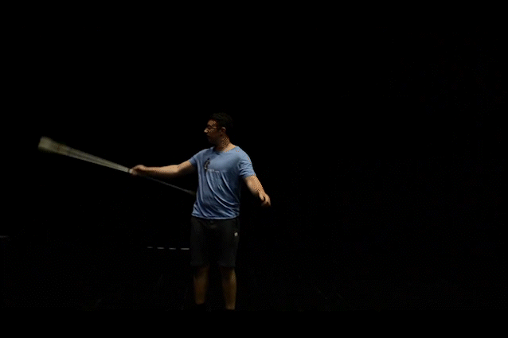

# Halo Connected Half Angel Pattern

---
Status: Learned
Family: Angel, Halo
How badly do I need it: ⭐⭐⭐⭐⭐
Difficulty: 💀💀💀
Mastery: 🌟🌟🌟🌟
Extra notes: Needs Angel roll place on same shoulder same hand
Ingest: No
Staff Type: Contact
Where was it first learned: MCP
id: 6faa98ff0fff4aa7ad7c427b287f057b
---

An angel roll split in half and connected by a halo roll and a pinwheel.

[https://youtu.be/DnkzBTvaigQ](https://youtu.be/DnkzBTvaigQ)
