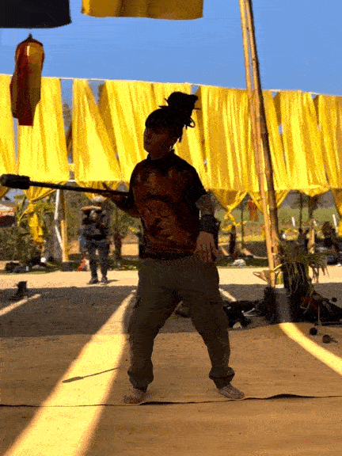

# Jesus Roll

---
Status: Learned
Family: Angel
Category: Move
How badly do I need it: 5
Difficulty: 4
Mastery: 3
Ingest: No
Staff Type: Contact
Where was it first learned: EJC 2025, Insta
id: 1fa6b010191f80a4ac26d78871c46d87
---

Instructions:

I begin by entering from a halo on my right shoulder. As the staff moves past the center of my head/neck, I perform a 180-degree turn, pivoting on my left foot. For the staff to stay controlled on the chest bent knees and an open chest. When the staff becomes vertical, I pivot again—this time on my right foot (stepping the left foot backward)—to complete another 180-degree turn, returning to face the same direction as when I started. This will result in a full 360-degree rotation, with the staff exiting over the left shoulder.

[https://www.instagram.com/p/DFw7xYXTAoq/](https://www.instagram.com/p/DFw7xYXTAoq/)

Important Note:

Bend from your knees, not your back, to avoid injury.
