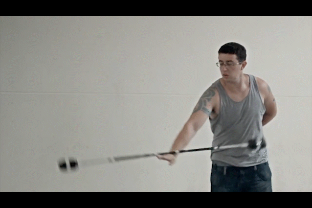

# Rolling fishtail

---
Status: Learned
Family: Fishtail
How badly do I need it: 2
Difficulty: 2
Mastery: 4
Ingest: No
Staff Type: Dragon
id: 042914ba582844cb85b99ef8ab60bfa9
---

Rolling Fishtails, also a Dragonstaff move. A very small fine move, especially with a fat dragonstaff. Just a roll that goes along the hand, while you are doing a fishtail.

[https://youtu.be/E57donJG-Nw](https://youtu.be/E57donJG-Nw)
