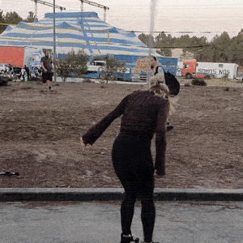

# SNES 180

---
Status: Training
Family: SNES
How badly do I need it: 3
Difficulty: 4
Mastery: 4
Improvement notes: Break into long and short
Drill reps: Foundation
Ingest: No
Staff Type: Contact
Where was it first learned: La Papet 2024
id: 3e1e154be91041a8bb93fb3773748ef2
---

Turn same direction as staff, so starting in your left hand, catch with your right neck, circle in front then step over right foot

Left to right, long end down

Right to left, short end down

Right → Left, Long end down

Right to left, long end down
