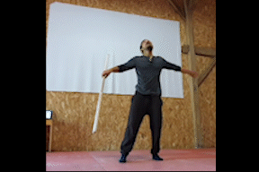
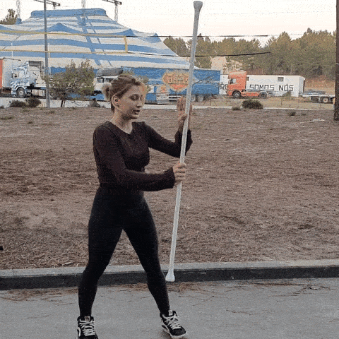

# SNES

---
Status: Training
Family: SNES
Category: Fundamental
How badly do I need it: ⭐⭐⭐⭐
Difficulty: 💀💀💀💀
Mastery: 🌟🌟🌟🌟
Drill reps: Foundation
Ingest: No
Staff Type: Contact
Where was it first learned: La Papet 2024
id: 8770a0f2776d4f63a594892d34a36e63
---

the snes video includes the backwards hand thing)

<aside>
💡

You can use the before and after neck pinch points for more control

</aside>

Finally, if at the end of the trick, the staff keeps rolling real fast down your arm and flying off, push your shoulder up more, and really turn. Plus if you bend your arm to grab it with the same hand as the shoulder it's coming off, you can use your forearm to push it up into the correct ending. Hmmmm.

[https://youtu.be/8eiA-N4-ggU](https://youtu.be/8eiA-N4-ggU)
