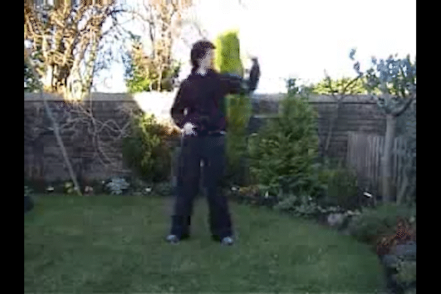

# Trap to BTB transfer

---
Status: Up next
Family: Elbow
How badly do I need it: 4
Difficulty: 4
Extra notes: Similar to BTB steve but uses elbow instead of wrist
Ingest: No
Staff Type: Contact
id: 3c35f4c548e64603b499b35f4d26ccf1
---

This is an elbow pass, not like the wrist BTB pass

[https://youtu.be/hUBQOQg0t0Y](https://youtu.be/hUBQOQg0t0Y)
