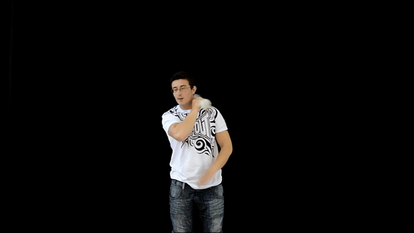

# Tutted Transfer

---
Status: Learned
Family: Steve
Category: Transfer
How badly do I need it: 2
Difficulty: 4
Mastery: 3
Extra notes: Don’t twist your arm
Ingest: No
Staff Type: Contact
id: e1bd749a3fa84a7d83e7afd1d4a9fa6e
---

Don’t twist your arm when doing this move

Aim to make the switch between the two states as the staff crosses your face

You can flatten your arms or do a sort of jump switch

[Tutted STEVE TRANSFER - Contact Staff Tutorials - mcp (720p_24fps_H264-192kbit_AAC).mp4](Tutted%20Transfer/Tutted_STEVE_TRANSFER_-_Contact_Staff_Tutorials_-_mcp_(720p_24fps_H264-192kbit_AAC).mp4)
